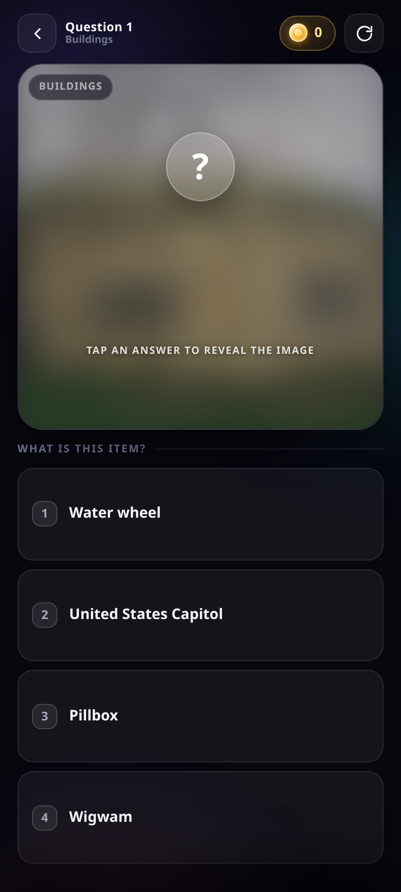
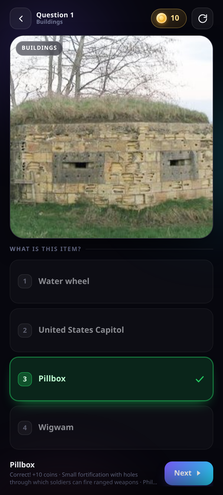
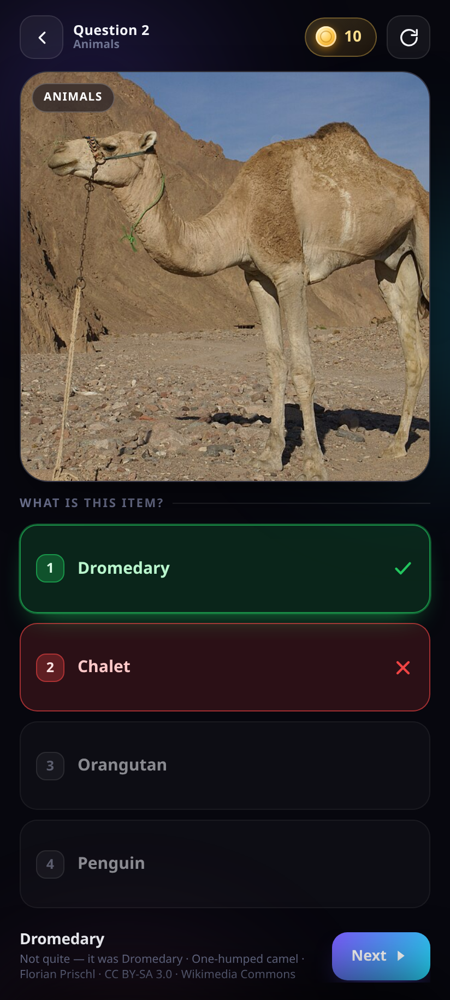
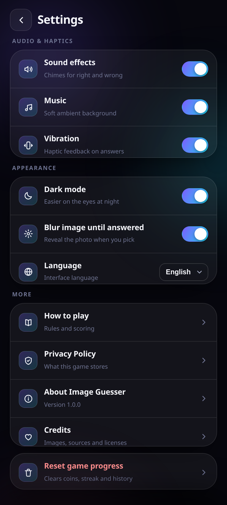
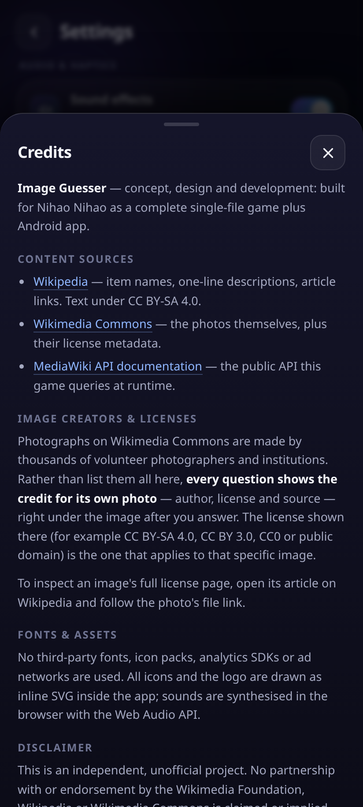
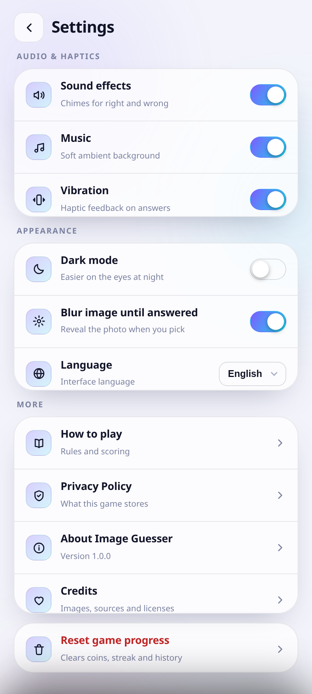
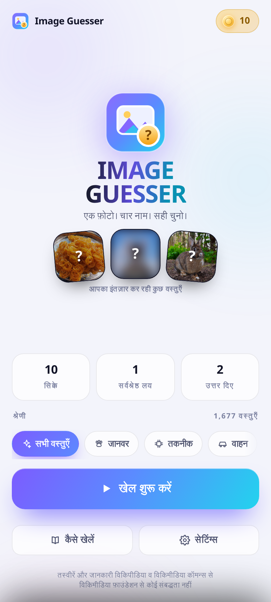

# IMAGE GUESSER

**One real photo. Four names. Ten coins for the right answer.**

A worldwide image quiz that never runs out of questions. Every round shows a genuine photograph of
something that exists on this planet — a lion, a synthesizer, a biryani, a Burj Khalifa, a soldering
iron, a moonscape — and you have to name it. Ships with **1,677 curated items** across **11 categories**
and keeps pulling fresh ones live from Wikipedia.

- **Android APK:** [download v1.0.0](https://github.com/technicalnihilist-lgtm/image-guesser/releases/latest/download/ImageGuesser.apk) — signed, 222 KB, Android 7.0+ (minSdk 24)
- **Play in the browser:** <https://technicalnihilist-lgtm.github.io/image-guesser/> (installable PWA — add to home screen)
- No accounts, no ads, no analytics, no trackers. Coins live on your device.

### App details

| | |
|---|---|
| **Name** | Image Guesser |
| **Package name** | `com.imageguesser.app` |
| **Version** | 1.0.0 (versionCode 1) |
| **Category** | Games — trivia / quiz |
| **Author** | technicalnihilist-lgtm |
| **Requires** | Android 7.0+ (minSdk 24), no GMS, no Play Services |
| **Size** | 222 KB |
| **Permissions** | INTERNET, ACCESS_NETWORK_STATE, VIBRATE |
| **License** | MIT (code) — photos keep their own Wikimedia licenses |
| **Icon** | [icon-512.png](https://raw.githubusercontent.com/technicalnihilist-lgtm/image-guesser/main/icon-512.png) |
| **APK** | [ImageGuesser.apk](https://github.com/technicalnihilist-lgtm/image-guesser/releases/latest/download/ImageGuesser.apk) |

---

## Screenshots

| Home | The photo stays blurred… | …and clears when you answer |
|---|---|---|
|  |  |  |

| Wrong answer | Settings | Credits & licensing |
|---|---|---|
|  |  |  |

| Light mode | हिन्दी |
|---|---|
|  |  |

---

## How it plays

1. A real photo appears — **blurred on purpose**, so you have to commit.
2. Exactly **four options**, exactly one correct.
3. Tap an answer: the photo snaps into focus, the right option turns green, a wrong pick turns red
   and shakes. The item's name, a one-line fact and the **photo credit** appear underneath.
4. **Correct = +10 coins.** Wrong = 0. Coins, best streak and answered count are saved instantly.
5. The next question loads on its own (or tap **Next**), and **refresh** pulls a brand-new photo any time.

Keyboard on desktop: `1`–`4` to answer, `R` for a new photo, `Esc` back.

## What is in the box

| | |
|---|---|
| **1,677 items** | Validated one by one against the Wikipedia API — every one has a real, loadable photo |
| **11 categories + 2 modes** | Animals · Technology · Vehicles · Food · Nature · History · Science · Buildings · Sports · Household · Arts & Music, plus **All items** and **Random World** |
| **Live discovery** | *Random World* (and a slice of *All items*) pulls brand-new articles from Wikipedia at runtime, so the quiz keeps teaching you things |
| **Zero repeats** | Every seen item is remembered (1,400-deep history, persisted) — you will not see the same photo twice until you have been through the whole pool |
| **Blur-reveal** | The core mechanic, and it can be switched off in Settings if you just want to look and guess |
| **Coins** | +10 per correct answer, animated coin burst, stored in `localStorage`, never reset unless you ask |
| **Sound & haptics** | Synthesised chimes (no audio files), ambient pad, vibration — each individually toggleable |
| **Dark & light** | Full theme system, remembered across launches |
| **6 languages** | English, हिन्दी, বাংলা, தமிழ், తెలుగు, मराठी |
| **Honest failure states** | Missing image → automatic retry at another size → automatic swap to a different item; offline → banner plus saved questions |

## Where the content comes from

Item names, one-line descriptions and photographs come from **Wikipedia** and **Wikimedia Commons**
through the public [MediaWiki API](https://www.mediawiki.org/wiki/API:Main_page):

- **Item pool** — built at build time by `tools/build_db.py`, which resolves every seed title against
  `action=query&prop=pageimages`, drops missing pages and disambiguation pages, and keeps only items
  that actually have a usable photograph.
- **Live items** — `generator=random` at runtime, filtered to articles that have a photographic
  (JPEG) thumbnail and are not settlements, people, albums, films, chemical compounds or other
  abstract titles.
- **Credits** — after each answer the app queries `prop=imageinfo&iiprop=extmetadata` for that exact
  file and shows **author · license · Wikimedia Commons**. Attribution travels with the photo instead
  of being buried in a list nobody reads.

Image Guesser is an independent project. It is **not** affiliated with, endorsed by or sponsored by
the Wikimedia Foundation. See [CREDITS.md](CREDITS.md) and [PRIVACY.md](PRIVACY.md).

## Install

**Android** — download [`ImageGuesser.apk`](https://github.com/technicalnihilist-lgtm/image-guesser/releases/latest/download/ImageGuesser.apk) and open it. Android will ask you to
allow installs from this source; the APK is signed with the project's own key (no Play Store, no
services, no updates pushed behind your back).

**Browser** — open <https://technicalnihilist-lgtm.github.io/image-guesser/>, or serve the folder locally (`python3 -m http.server`). Chrome/Safari will
offer "Add to Home screen", and the service worker caches the shell plus every image you have seen,
so it opens instantly and starts even without a connection.

## Build it yourself

The whole game is **one HTML file** with no frameworks, no bundler and no dependencies.

```bash
# 1. rebuild the item database (needs internet, ~1 minute)
python3 tools/build_db.py          # writes db.json from Wikipedia
python3 tools/build_game.py        # assembles index.html from src/ + db.json

# 2. build the Android APK (no Gradle)
bash app/setup-toolchain.sh        # downloads JDK 17 + build-tools 34 + platform 34
export JAVA_HOME=$PWD/.toolchain/jdk ANDROID_SDK_ROOT=$PWD/.toolchain/sdk
bash app/build.sh                  # aapt2 + javac + d8 + zipalign + apksigner
```

```
index.html                 the entire game (app shell + 1,677 items inlined)
src/style.css              design system, glass UI, dark/light themes
src/body.html              screens, logo, icon sprite
src/i18n.js                6-language interface strings
src/app.js                 engine: questions, coins, audio, settings, credits
tools/build_db.py          Wikipedia → verified item database
tools/build_game.py        src/ + db.json → index.html
app/                       Android WebView shell (Java, 150 lines), manifest, icons
sw.js, manifest.json       PWA install + offline cache
screenshots/               the images in this README
```

## Technical notes

- **No dependencies at runtime** — no React, no fonts, no icon packs, no CDN. Icons and the logo are
  inline SVG; sounds are generated with the Web Audio API.
- **APK size 222 KB**, one WebView, one activity, three permissions (INTERNET, ACCESS_NETWORK_STATE, VIBRATE).
- **Images are cached** by the browser and by the service worker (`upload.wikimedia.org` is
  cache-first, the API is network-first with a cached fallback).
- **Responsive** from 320 px phones to tablets; safe-area insets respected on notched devices;
  `prefers-reduced-motion` honoured.
- **The database is expandable** — add titles to `tools/build_db.py`, re-run it, rebuild.

## License

Code: MIT (see [LICENSE](LICENSE)). Wikipedia text is CC BY-SA 4.0; each photograph keeps its own
license, shown in-app with the photo. "Wikipedia" and "Wikimedia" are trademarks of the Wikimedia
Foundation and are used here only to describe the source of the content.
