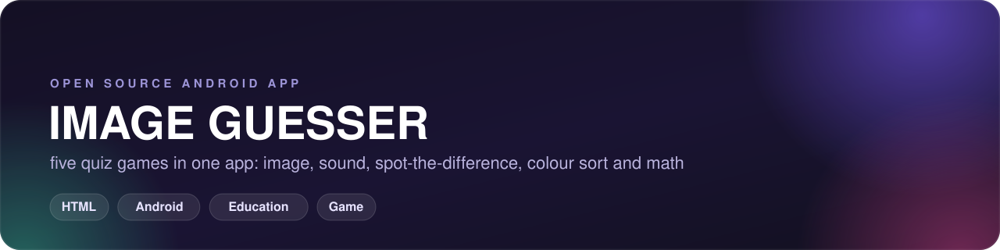
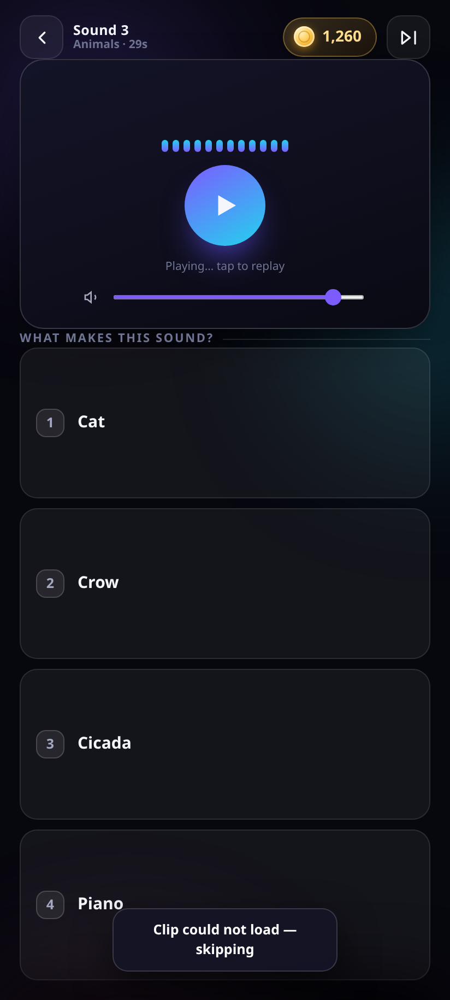
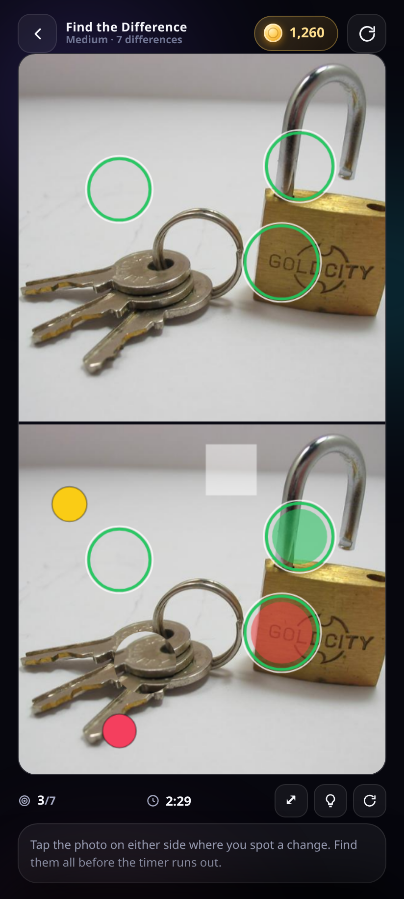
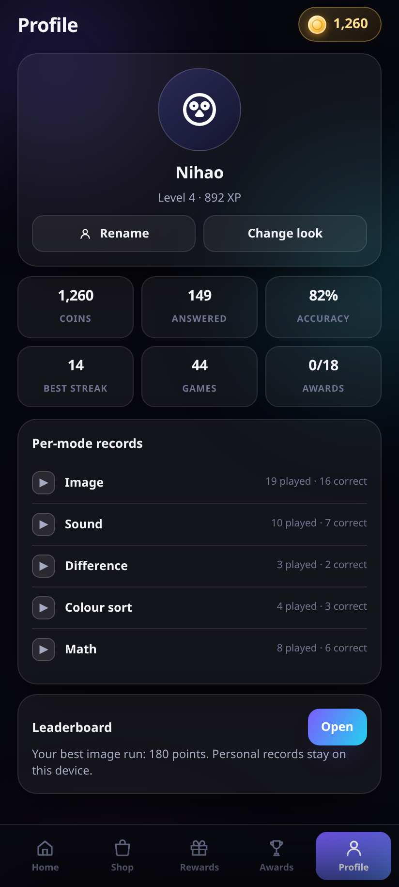
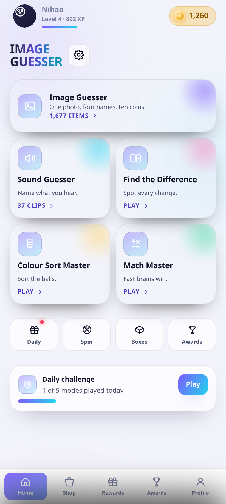

<div align="center">




<a href="https://github.com/technicalnihilist-lgtm/image-guesser/stargazers"></a>&nbsp;<a href="https://github.com/technicalnihilist-lgtm/image-guesser/network/members"></a>

<a href="https://github.com/technicalnihilist-lgtm/image-guesser/releases/latest/download/ImageGuesser.apk"></a> <a href="https://technicalnihilist-lgtm.github.io/apps-site/apps/image-guesser.html"></a>

<b>Support the work</b>

  

<sub>Donations aren't live yet — Paytm, UPI, PayPal and Buy&nbsp;Me&nbsp;a&nbsp;Coffee all show <b>coming soon</b>. Until then, a ⭐ star is the best support.</sub>

<a href="https://github.com/technicalnihilist-lgtm/image-guesser/releases/latest"></a>  <a href="https://github.com/technicalnihilist-lgtm/image-guesser/releases"></a>

</div>

---

## The five modes

| Mode | What you do | Reward |
|---|---|---|
| **Image Guesser** | A real photo — blurred until you commit — and four names. 1,677 items, 11 categories. | +10 coins per correct answer |
| **Sound Guesser** | A real recording from Wikimedia Commons. Replay it, set the volume, name the source. | +10 coins |
| **Find the Difference** | Two versions of one photo, differences generated at known coordinates. Tap them all before the timer ends. | +10 coins, +5 for no hints |
| **Colour Sort Master** | Pour balls between glass tubes until every tube holds one colour. Every puzzle is generated solvable. | +10 coins, +5 for move efficiency |
| **Math Master** | Timed arithmetic, patterns, equations and brain teasers with worked explanations. Four options or typed answers. | +10 coins, +5 on a 5-streak |

Every mode also has a **daily challenge** seeded by today's date, plus a **+25 coin** bonus per
challenge and **+50** for playing all five in one day.

## Screenshots

| Home | Image Guesser | Sound Guesser |
|---|---|---|
|  |  |  |

| Find the Difference | Colour Sort | Math Master |
|---|---|---|
|  |  |  |

| Shop | Rewards & wheel | Boxes |
|---|---|---|
|  |  |  |

| Awards & missions | Profile | Light mode |
|---|---|---|
|  |  |  |

## Coins, shop and rewards

One wallet across all five modes. **Correct answer = 10 coins, wrong = 0**, and the balance is written
to disk the moment it changes — a refresh, a new question or a reinstall of the level never touches it.

| Boosters | Price | Looks | Price |
|---|---|---|---|
| Hint | 50 | New avatar (×4) | 500 |
| Extra life | 100 | Profile frame (×2) | 300 |
| Skip question | 150 | Game theme (×2) | 700 |
| 2X reward booster (next 10 rewards) | 300 | Special crown | 1,000 |
| | | VIP profile effect | 2,000 |

Cosmetics are **permanent once bought**, and can be equipped or removed at any time. Purchases show a
confirmation with price and balance first, and are refused outright if you cannot afford them.

**Daily rewards** run a 7-day cycle (10 → 20 → 30 → 50 → 75 → 100 → 200 coins) and cannot be claimed
twice in a day. The **spin wheel** gives one free spin daily; the **treasure boxes** (Bronze 200,
Silver 500, Gold 1,000, Diamond 2,500) publish their exact odds in the app, both on the box cards and
in "See reward chances". Everything is generated locally with a fair RNG — no real money exists
anywhere in this game.

## Achievements, missions and profile

18 achievements (first correct answer, 10/50/100 correct, 10-streak, 25 image answers, 10 sound
answers, 25 maths answers, 5 difference puzzles, 10 sort levels, all five modes, 7 daily claims, 10
missions, 1,000 coins earned, 80% accuracy, expert puzzles), plus rotating **daily** and **weekly
missions** with claim buttons and progress bars.

The profile tracks coins, questions answered, correct/incorrect, accuracy, games played, levels
completed, best streaks, per-mode records and claimed awards — and shows your equipped avatar, frame,
crown and effect.

**About the leaderboard:** it ranks *your own* runs on this device, by mode, for all time / this week /
this month. It deliberately shows no invented players — a worldwide board needs a server and an
account, and this app ships without either. Say the word and it can be wired to a backend.

## How it plays, honestly

- **Images and sounds are real** — 1,677 verified image items and 37 licensed audio clips, all from
  Wikipedia and Wikimedia Commons, each credited with author and license inside the game.
- **Every difference puzzle is solvable** because the differences are generated at known coordinates
  and drawn onto the second image; the app never guesses where they are.
- **Every colour-sort level is solvable** because it is built by *undoing* legal moves from the solved
  state, so a solution always exists by construction.
- **Every maths question is computed** in code with its answer and a worked explanation — 300 generated
  questions per build are checked for a unique correct option.

## Install

**Android** — download [`ImageGuesser.apk`](https://github.com/technicalnihilist-lgtm/image-guesser/releases/latest/download/ImageGuesser.apk)
and open it (allow installs from this source when prompted). v2.0.0 is signed with the same key as
v1.0.0, so it installs straight over the old version and keeps your coins.

**Browser** — open <https://technicalnihilist-lgtm.github.io/image-guesser/>, or serve the folder
locally. The service worker caches the shell and every image/audio file you have played.

## Build it yourself

```bash
## Technical notes

- **No runtime dependencies** — no React, no fonts, no icon packs, no CDN, no analytics. All graphics
  are inline SVG or CSS; game sounds are synthesised with the Web Audio API.
- **250 KB APK**, one activity, three permissions, minSdk 24 / targetSdk 34.
- **Local-first save**: coins, purchases, achievements, missions, statistics and item history live in
  `localStorage` and are deep-merged against defaults on load, so a partial or old save never breaks
  the app. Settings → **Backup & restore** exports and imports the whole save as a code.
- **Accessibility**: 44 px+ targets, aria roles on switches, keyboard play (`1`–`4`, `R`, `Esc`),
  `prefers-reduced-motion` respected, light theme, 6 interface languages.
- **Failure handling**: image retry at another size → swap to a different item → offline banner;
  audio error → skip the clip; every network path degrades to something playable.

## License

Code: MIT (see [LICENSE](LICENSE)). Wikipedia text is CC BY-SA 4.0; each photograph and recording keeps
its own license, shown in-app with the item. "Wikipedia" and "Wikimedia" are trademarks of the
Wikimedia Foundation, used here only to describe the source of the content. This is an independent
project — no partnership or endorsement is claimed.

---

## 🌍 Languages

<sub>Donations are <b>coming soon</b> in every language below — nothing to pay today, nothing to click.</sub>

<div align="center">

<sub><b>हिन्दी · বাংলা · मराठी · తెలుగు · தமிழ் · ગુજરાતી · ಕನ್ನಡ · മലയാളം · ਪੰਜਾਬੀ · ଓଡ଼ିଆ · অসমীয়া · اردو</b></sub>

</div>

<details>
<summary><b>🌍 Open the same message in 53 languages</b></summary>

**🇮🇳 Indian languages**

- **हिन्दी** (Hindi) — ☕ जल्द ही आ रहा है। · ⭐ अगर आपको यह ऐप और हमारा काम पसंद है, तो कृपया रिपॉजिटरी को स्टार दें और हमें फॉलो करें।
- **বাংলা** (Bengali) — ☕ খুব শিগগিরই আসছে। · ⭐ যদি আপনার এই অ্যাপ এবং আমাদের কাজ ভালো লাগে, তবে অনুগ্রহ করে রিপোজিটরিটিকে একটি স্টার দিন এবং আমাদের ফলো করুন।
- **मराठी** (Marathi) — ☕ लवकरच येत आहे. · ⭐ जर तुम्हाला हे ॲप आणि आमचं काम आवडलं असेल, तर कृपया रिपॉझिटरीला स्टार द्या आणि आम्हाला फॉलो करा.
- **తెలుగు** (Telugu) — ☕ త్వరలో రాబోతోంది. · ⭐ మీకు ఈ యాప్, మా పని నచ్చితే, దయచేసి రిపోజిటరీకి ఒక స్టార్ ఇచ్చి మమ్మల్ని ఫాలో అవ్వండి.
- **தமிழ்** (Tamil) — ☕ விரைவில் வருகிறது. · ⭐ உங்களுக்கு இந்த ஆப்பும் எங்க வேலையும் பிடிச்சிருந்தா, தயவுசெஞ்சு இந்த ரெபாசிட்டரிக்கு ஒரு ஸ்டார்…
- **ગુજરાતી** (Gujarati) — ☕ ટૂંક સમયમાં આવી રહ્યું છે. · ⭐ જો તમને આ એપ અને અમારું કામ ગમતું હોય, તો પ્લીઝ રિપોઝિટરીને સ્ટાર આપો અને અમને ફોલો કરો.
- **ಕನ್ನಡ** (Kannada) — ☕ ಶೀಘ್ರದಲ್ಲೇ ಬರುತ್ತಿದೆ. · ⭐ ನಿಮಗೆ ಈ ಆ್ಯಪ್ ಮತ್ತು ನಮ್ಮ ಕೆಲಸ ಇಷ್ಟವಾದರೆ, ದಯವಿಟ್ಟು ರೆಪೊಸಿಟರಿಗೆ ಸ್ಟಾರ್ ಕೊಡಿ ಮತ್ತು ನಮ್ಮನ್ನು ಫಾಲೋ ಮಾಡಿ.
- **മലയാളം** (Malayalam) — ☕ ഉടൻ വരുന്നു. · ⭐ നിങ്ങൾക്ക് ഈ ആപ്പും ഞങ്ങളുടെ പ്രവർത്തനവും ഇഷ്ടപ്പെട്ടെങ്കിൽ, ദയവായി റെപ്പോസിറ്ററിക്ക് ഒരു സ്റ്റാർ…
- **ਪੰਜਾਬੀ** (Punjabi) — ☕ ਜਲਦੀ ਆ ਰਿਹਾ ਹੈ। · ⭐ ਜੇ ਤੁਹਾਨੂੰ ਇਹ ਐਪ ਅਤੇ ਸਾਡਾ ਕੰਮ ਪਸੰਦ ਹੈ, ਤਾਂ ਕਿਰਪਾ ਕਰਕੇ ਰਿਪੋਜ਼ਟਰੀ ਨੂੰ ਸਟਾਰ ਦਿਓ ਅਤੇ ਸਾਨੂੰ ਫਾਲੋ ਕਰੋ।
- **ଓଡ଼ିଆ** (Odia) — ☕ ଖୁବ୍ ଶୀଘ୍ର ଆସୁଛି। · ⭐ ଯଦି ଆପଣଙ୍କୁ ଏହି ଆପ୍ ଏବଂ ଆମର କାମ ଭଲ ଲାଗୁଛି, ତେବେ ଦୟାକରି ରିପୋଜିଟୋରୀକୁ ଗୋଟିଏ ଷ୍ଟାର୍ ଦିଅନ୍ତୁ ଏବଂ ଆମକୁ ଫଲୋ କରନ୍ତୁ।
- **অসমীয়া** (Assamese) — ☕ অতি সোনকালেই আহি আছে। · ⭐ যদি আপুনি এই এপটো আৰু আমাৰ কাম ভাল পায়, তেন্তে অনুগ্ৰহ কৰি ৰিপজিটৰীটোক এটা ষ্টাৰ দিয়ক আৰু আমাক ফ'ল' কৰক।
- **اردو** (Urdu) — ☕ جلد آرہا ہے۔ · ⭐ اگر آپ کو یہ ایپ اور ہمارا کام پسند آئے تو براہ کرم ریپازٹری کو سٹار دیں اور ہمیں فالو کریں۔
- **संस्कृतम्** (Sanskrit) — ☕ शीघ्रमेव आगच्छति।
- **मैथिली** (Maithili) — ☕ जल्दिये आबि रहल अछि।
- **कोंकणी** (Konkani) — ☕ रोखडेंच येता.
- **کٲشُر** (Kashmiri) — ☕ جَلدی یِوان چھُ۔
- **سنڌي** (Sindhi) — ☕ जल्द अची रह्यो आहे।
- **डोगरी** (Dogri) — ☕ जल्दी आ करदा ऐ।
- **ꯃꯤꯇꯩ ꯂꯣꯟ** (Manipuri) — ☕ ꯑꯊꯨꯕꯥ ꯃꯇꯝꯗꯥ ꯂꯥꯛꯀꯅꯤ꯫
- **बर’** (Bodo) — ☕ थाबैनो फैगोन।
- **ᱥᱟᱱᱛᱟᱲᱤ** (Santali) — ☕ ᱞᱚᱜᱚᱱ ᱦᱤᱡᱩᱜ ᱠᱟᱱᱟ᱾
- **नेपाली** (Nepali) — ☕ छिट्टै आउँदैछ। · ⭐ यदि तपाईंलाई यो एप र हाम्रो काम मन पर्‍यो भने, कृपया रिपोजिटरीलाई स्टार दिनुहोस् र हामीलाई फलो गर्नुहोस्।

**🌍 World languages**

- **العربية** (Arabic) — ☕ قريبًا. · ⭐ إذا أعجبك هذا التطبيق وعملنا، فيرجى منح المستودع نجمة ومتابعتنا.
- **简体中文** (Chinese (Simplified)) — ☕ 即将推出。
- **繁體中文** (Chinese (Traditional)) — ☕ 即將推出。
- **Čeština** (Czech) — ☕ Již brzy.
- **Dansk** (Danish) — ☕ Kommer snart.
- **Nederlands** (Dutch) — ☕ Binnenkort beschikbaar. · ⭐ Vind je deze app en ons werk leuk?
- **Filipino** (Filipino) — ☕ Malapit na.
- **Suomi** (Finnish) — ☕ Tulossa pian.
- **Français** (French) — ☕ Bientôt disponible. · ⭐ Si cette application et notre travail vous plaisent, mettez une étoile au dépôt et suivez-nous.
- **Deutsch** (German) — ☕ Bald verfügbar. · ⭐ Wenn dir diese App und unsere Arbeit gefallen, gib dem Repository einen Stern und folge uns.
- **Ελληνικά** (Greek) — ☕ Έρχεται σύντομα.
- **עברית** (Hebrew) — ☕ בקרוב.
- **Magyar** (Hungarian) — ☕ Hamarosan.
- **Bahasa Indonesia** (Indonesian) — ☕ Segera hadir. · ⭐ Jika kamu suka aplikasi ini dan karya kami, beri bintang pada repositori ini dan ikuti kami.
- **Italiano** (Italian) — ☕ In arrivo.
- **日本語** (Japanese) — ☕ 近日公開。 · ⭐ このアプリと私たちの仕事が気に入ったら、リポジトリにスターを付けてフォローしてください。
- **한국어** (Korean) — ☕ 곧 공개됩니다. · ⭐ 이 앱과 저희 작업이 마음에 드신다면 저장소에 스타를 눌러 주시고 팔로우해 주세요.
- **Bahasa Melayu** (Malay) — ☕ Akan datang.
- **Norsk** (Norwegian) — ☕ Kommer snart.
- **فارسی** (Persian) — ☕ به‌زودی.
- **Polski** (Polish) — ☕ Wkrótce. · ⭐ Jeśli podoba Ci się ta aplikacja i nasza praca, daj repozytorium gwiazdkę i obserwuj nas.
- **Português** (Portuguese) — ☕ Em breve.
- **Română** (Romanian) — ☕ În curând.
- **Русский** (Russian) — ☕ Скоро. · ⭐ Если вам нравится это приложение и наша работа, поставьте звёздочку репозиторию и подпишитесь на нас.
- **Español** (Spanish) — ☕ Muy pronto. · ⭐ Si te gusta esta app y nuestro trabajo, dale una estrella al repositorio y síguenos.
- **Kiswahili** (Swahili) — ☕ Inakuja hivi karibuni.
- **Svenska** (Swedish) — ☕ Kommer snart.
- **ไทย** (Thai) — ☕ เร็ว ๆ นี้
- **Türkçe** (Turkish) — ☕ Çok yakında.
- **Українська** (Ukrainian) — ☕ Незабаром.
- **Tiếng Việt** (Vietnamese) — ☕ Sắp ra mắt. · ⭐ Nếu bạn thích ứng dụng này và công việc của chúng tôi, hãy tặng kho lưu trữ một ngôi sao và theo…

</details>

