# IMAGE GUESSER

**Five quiz games. One coin wallet. One profile.**

A complete mobile gaming app: guess real photos, recognise real sounds, spot the difference, sort the
colours and out-run the clock on maths — all sharing a single wallet, shop, achievement system and
profile. Built as one self-contained HTML app and shipped as a signed Android APK.

- **Android APK:** [download v2.0.0](https://github.com/technicalnihilist-lgtm/image-guesser/releases/latest/download/ImageGuesser.apk) — signed, 250 KB, Android 7.0+ (minSdk 24)
- **Play in the browser:** <https://technicalnihilist-lgtm.github.io/image-guesser/> (installable PWA)
- No accounts, no ads, no analytics, no trackers. Everything you earn stays on your device.

### App details

| | |
|---|---|
| **Name** | Image Guesser |
| **Package name** | `com.imageguesser.app` |
| **Version** | 2.0.0 (versionCode 2) |
| **Category** | Games — trivia / puzzle |
| **Author** | technicalnihilist-lgtm |
| **Requires** | Android 7.0+ (minSdk 24), no GMS, no Play Services |
| **Size** | 250 KB |
| **Permissions** | INTERNET, ACCESS_NETWORK_STATE, VIBRATE |
| **License** | MIT (code) — photos and audio keep their own Wikimedia licenses |
| **Icon** | [icon-512.png](https://raw.githubusercontent.com/technicalnihilist-lgtm/image-guesser/main/icon-512.png) |
| **APK** | [ImageGuesser.apk](https://github.com/technicalnihilist-lgtm/image-guesser/releases/latest/download/ImageGuesser.apk) |

---

## The five modes

| Mode | What you do | Reward |
|---|---|---|
| **Image Guesser** | A real photo — blurred until you commit — and four names. 1,677 items, 11 categories. | +10 coins per correct answer |
| **Sound Guesser** | A real recording from Wikimedia Commons. Replay it, set the volume, name the source. | +10 coins |
| **Find the Difference** | Two versions of one photo, differences generated at known coordinates. Tap them all before the timer ends. | +10 coins, +5 for no hints |
| **Colour Sort Master** | Pour balls between glass tubes until every tube holds one colour. Every puzzle is generated solvable. | +10 coins, +5 for move efficiency |
| **Math Master** | Timed arithmetic, patterns, equations and brain teasers with worked explanations. Four options or typed answers. | +10 coins, +5 on a 5-streak |

Every mode also has a **daily challenge** seeded by today's date, plus a **+25 coin** bonus per
challenge and **+50** for playing all five in one day.

## Screenshots

| Home | Image Guesser | Sound Guesser |
|---|---|---|
| 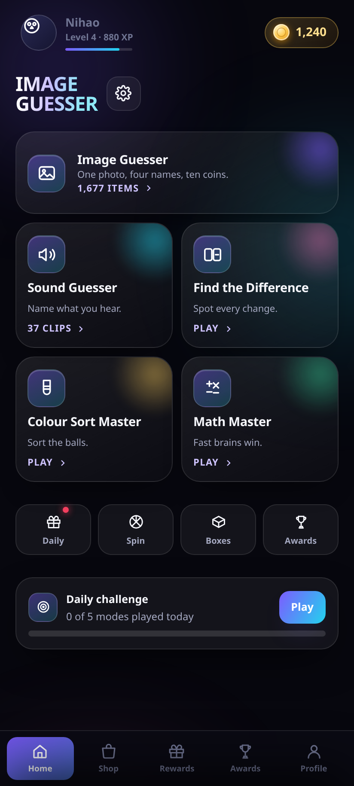 | 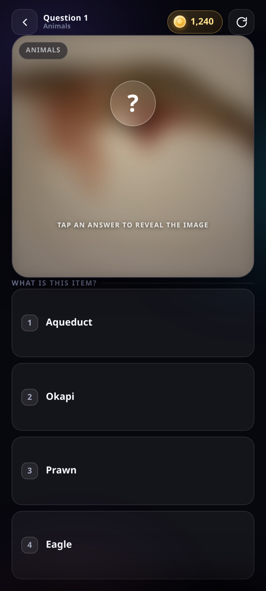 | 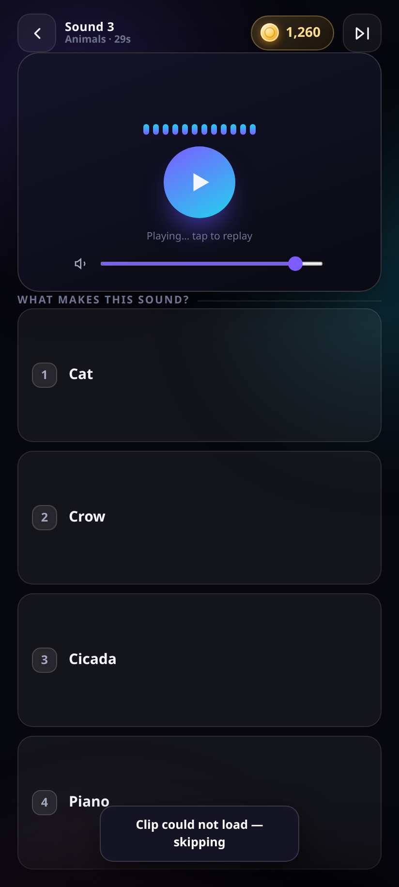 |

| Find the Difference | Colour Sort | Math Master |
|---|---|---|
| 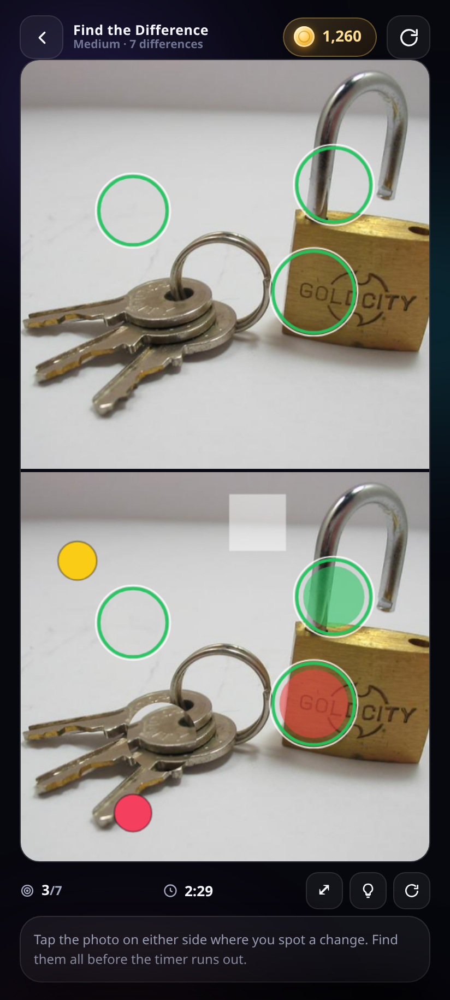 | 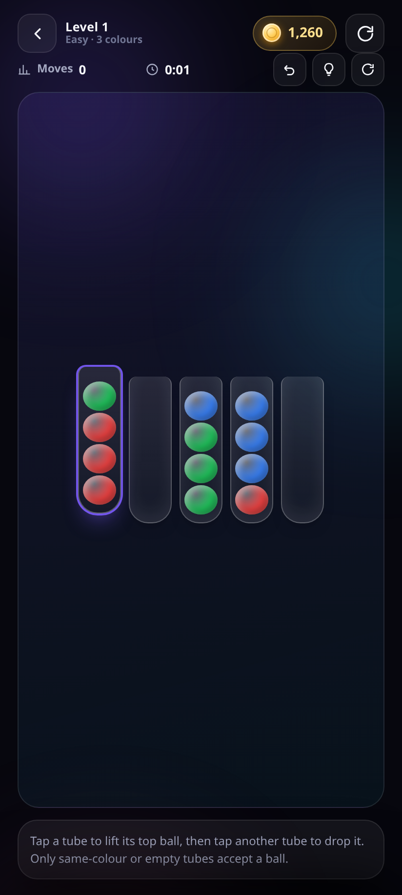 | 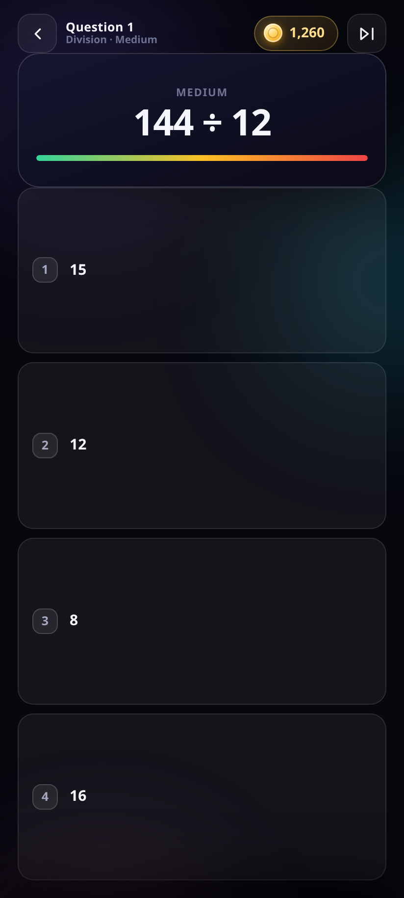 |

| Shop | Rewards & wheel | Boxes |
|---|---|---|
| 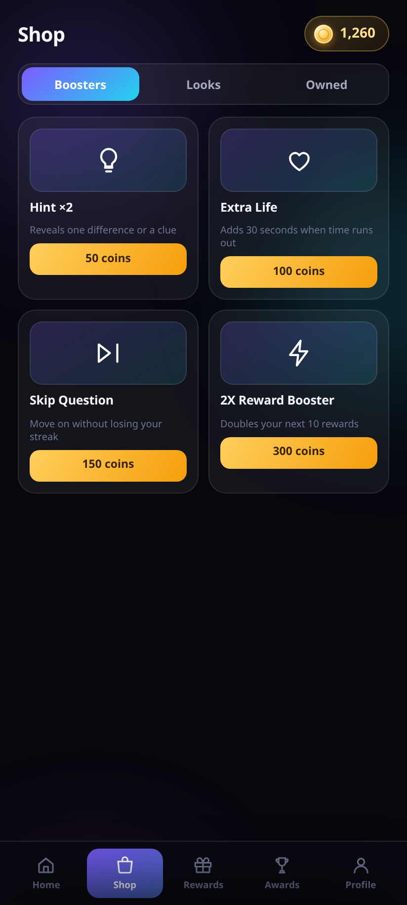 | 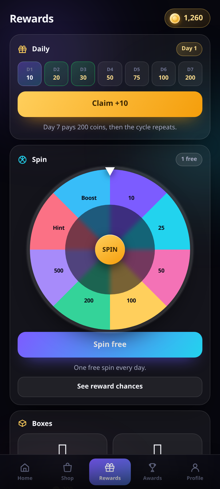 | 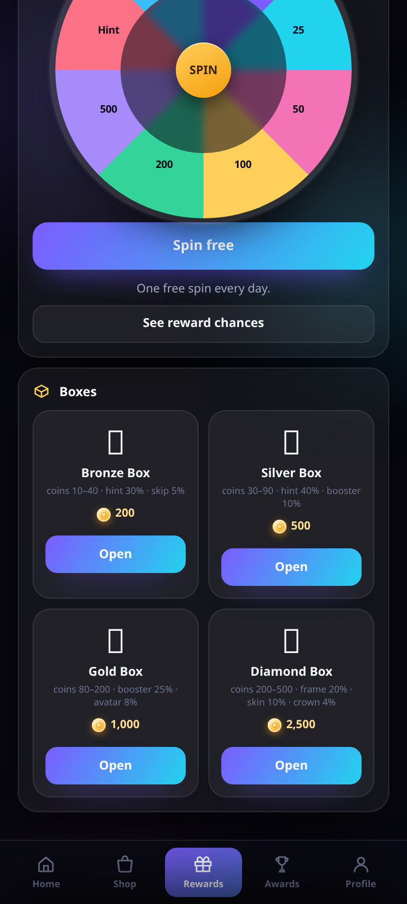 |

| Awards & missions | Profile | Light mode |
|---|---|---|
| 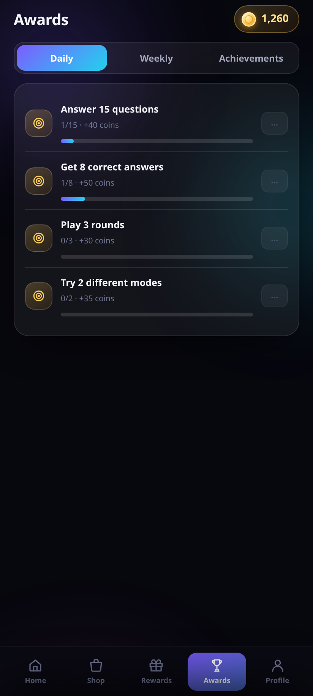 | 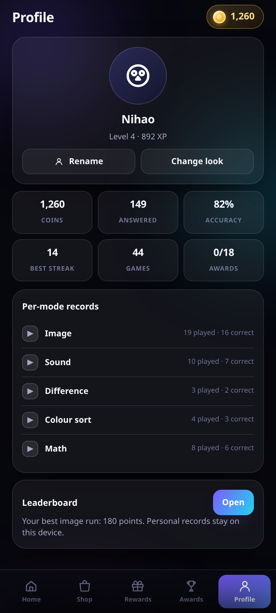 | 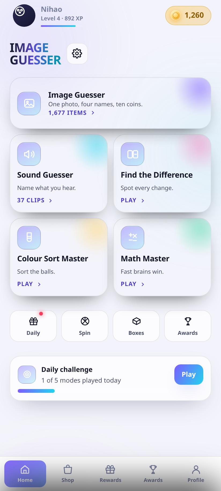 |

## Coins, shop and rewards

One wallet across all five modes. **Correct answer = 10 coins, wrong = 0**, and the balance is written
to disk the moment it changes — a refresh, a new question or a reinstall of the level never touches it.

| Boosters | Price | Looks | Price |
|---|---|---|---|
| Hint | 50 | New avatar (×4) | 500 |
| Extra life | 100 | Profile frame (×2) | 300 |
| Skip question | 150 | Game theme (×2) | 700 |
| 2X reward booster (next 10 rewards) | 300 | Special crown | 1,000 |
| | | VIP profile effect | 2,000 |

Cosmetics are **permanent once bought**, and can be equipped or removed at any time. Purchases show a
confirmation with price and balance first, and are refused outright if you cannot afford them.

**Daily rewards** run a 7-day cycle (10 → 20 → 30 → 50 → 75 → 100 → 200 coins) and cannot be claimed
twice in a day. The **spin wheel** gives one free spin daily; the **treasure boxes** (Bronze 200,
Silver 500, Gold 1,000, Diamond 2,500) publish their exact odds in the app, both on the box cards and
in "See reward chances". Everything is generated locally with a fair RNG — no real money exists
anywhere in this game.

## Achievements, missions and profile

18 achievements (first correct answer, 10/50/100 correct, 10-streak, 25 image answers, 10 sound
answers, 25 maths answers, 5 difference puzzles, 10 sort levels, all five modes, 7 daily claims, 10
missions, 1,000 coins earned, 80% accuracy, expert puzzles), plus rotating **daily** and **weekly
missions** with claim buttons and progress bars.

The profile tracks coins, questions answered, correct/incorrect, accuracy, games played, levels
completed, best streaks, per-mode records and claimed awards — and shows your equipped avatar, frame,
crown and effect.

**About the leaderboard:** it ranks *your own* runs on this device, by mode, for all time / this week /
this month. It deliberately shows no invented players — a worldwide board needs a server and an
account, and this app ships without either. Say the word and it can be wired to a backend.

## How it plays, honestly

- **Images and sounds are real** — 1,677 verified image items and 37 licensed audio clips, all from
  Wikipedia and Wikimedia Commons, each credited with author and license inside the game.
- **Every difference puzzle is solvable** because the differences are generated at known coordinates
  and drawn onto the second image; the app never guesses where they are.
- **Every colour-sort level is solvable** because it is built by *undoing* legal moves from the solved
  state, so a solution always exists by construction.
- **Every maths question is computed** in code with its answer and a worked explanation — 300 generated
  questions per build are checked for a unique correct option.

## Install

**Android** — download [`ImageGuesser.apk`](https://github.com/technicalnihilist-lgtm/image-guesser/releases/latest/download/ImageGuesser.apk)
and open it (allow installs from this source when prompted). v2.0.0 is signed with the same key as
v1.0.0, so it installs straight over the old version and keeps your coins.

**Browser** — open <https://technicalnihilist-lgtm.github.io/image-guesser/>, or serve the folder
locally. The service worker caches the shell and every image/audio file you have played.

## Build it yourself

```bash
# 1. rebuild the content databases (needs internet)
python3 tools/build_db.py          # 1,677 verified image items from Wikipedia
python3 tools/build_sounds.py      # 37 licensed clips from Wikimedia Commons
python3 tools/build_game.py        # assembles index.html from src/ + databases

# 2. build the Android APK (no Gradle)
bash app/setup-toolchain.sh        # JDK 17 + build-tools 34 + platform 34
export JAVA_HOME=$PWD/.toolchain/jdk ANDROID_SDK_ROOT=$PWD/.toolchain/sdk
bash app/build.sh                  # aapt2 + javac + d8 + zipalign + apksigner
```

```
index.html            the whole app (5 modes + 1,677 images + 37 sounds inlined)
src/style.css         design system, glass UI, themes, dark/light
src/style2.css        v2 components: mode cards, nav, wheel, boxes, tubes, canvases
src/body2.html        every screen, the logo and the icon sprite
src/core.js           wallet, economy, shop, daily, wheel, boxes, achievements, missions, profile
src/m-*.js            the five game engines
src/boot.js           wiring, keyboard, backup/restore
tools/                database builders (Wikipedia + Commons) and the packer
app/                  Android WebView shell (Java, 150 lines), manifest, icons, keystore
sw.js, manifest.json  PWA install + offline cache
screenshots/          the images in this README
```

## Technical notes

- **No runtime dependencies** — no React, no fonts, no icon packs, no CDN, no analytics. All graphics
  are inline SVG or CSS; game sounds are synthesised with the Web Audio API.
- **250 KB APK**, one activity, three permissions, minSdk 24 / targetSdk 34.
- **Local-first save**: coins, purchases, achievements, missions, statistics and item history live in
  `localStorage` and are deep-merged against defaults on load, so a partial or old save never breaks
  the app. Settings → **Backup & restore** exports and imports the whole save as a code.
- **Accessibility**: 44 px+ targets, aria roles on switches, keyboard play (`1`–`4`, `R`, `Esc`),
  `prefers-reduced-motion` respected, light theme, 6 interface languages.
- **Failure handling**: image retry at another size → swap to a different item → offline banner;
  audio error → skip the clip; every network path degrades to something playable.

## License

Code: MIT (see [LICENSE](LICENSE)). Wikipedia text is CC BY-SA 4.0; each photograph and recording keeps
its own license, shown in-app with the item. "Wikipedia" and "Wikimedia" are trademarks of the
Wikimedia Foundation, used here only to describe the source of the content. This is an independent
project — no partnership or endorsement is claimed.
